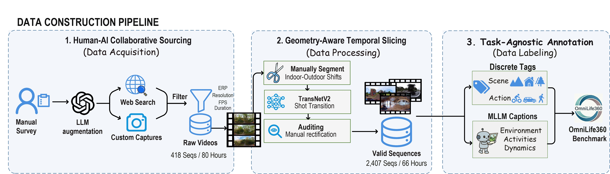
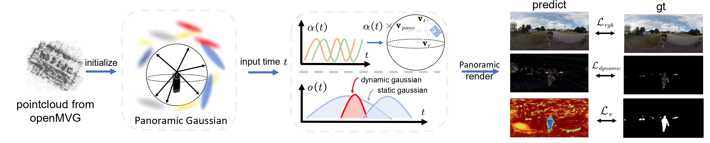
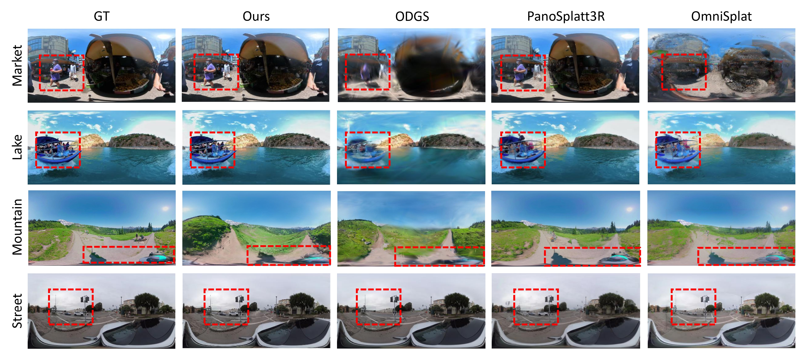

# OmniLife360: A Benchmark for 3D Reconstruction from In-the-Wild 360° Captures

> **OmniLife360: A Benchmark for 3D Reconstruction from In-the-Wild 360° Captures**,            
> Zonglin Zhao, Bowen Zhang, Yatai Li, Chao.Liang, Zhipeng Zhang  
> **ECCV 2026**

**Official implementation of "OmniLife360: A Benchmark for 3D Reconstruction from In-the-Wild 360° Captures".** 


## 🛠️ Pipeline
<div align="center">
  
</div><br/>
<div align="center">
  
</div><br/>


## Get started
### Environment
#### install openmvg
If you need to process your own data using OpenMVG, please follow the instructions below; otherwise, you can directly download our preprocessed [sample data](https://drive.google.com/file/d/1M92nbrpS5LaBfcqPdw0bMjpVKotTEgov/view?usp=sharing).
```
# install openmvg
git clone --recursive https://github.com/openMVG/openMVG.git

sudo apt-get install cmake libpng-dev libjpeg-dev libtiff-dev libxxf86vm1 libxxf86vm-dev libxi-dev libxrandr-dev graphviz

cd openMVG/src
mkdir build && cd build
cmake -DCMAKE_BUILD_TYPE=RELEASE -DCMAKE_POLICY_VERSION_MINIMUM=3.5 ..
make -j
sudo make install
```

#### install Omni4DGS
```
# Clone the repo.
git clone https://github.com/AutoLab-SAI-SJTU/Omni4DGS
cd Omni4DGS

# Make a conda environment.
conda create --name omni4dgs python=3.10
conda activate omni4dgs

# Select the PyTorch compatible with your CUDA version.
conda install pytorch==2.4.0 torchvision==0.19.0 torchaudio==2.4.0  pytorch-cuda=11.8 -c pytorch -c nvidia

# Install requirements.
pip install -r requirements.txt

# Install simple-knn
git clone https://gitlab.inria.fr/bkerbl/simple-knn.git
pip install ./simple-knn

# Install nvdiffrast (for Envlight)
git clone https://github.com/NVlabs/nvdiffrast
pip install ./nvdiffrast

# a modified gaussian splatting (for panoramic images)
cd submodules/panoramic_gaussian_rasterization
python setup.py install

```

### Data preparation
You can try our preprocessed [sample data](https://drive.google.com/file/d/1M92nbrpS5LaBfcqPdw0bMjpVKotTEgov/view?usp=sharing) or process your own follow the instruction below

Create a directory for the data: `mkdir data`.
#### OpenMVG dataset

First prepare your own dataset only need the rgb images:
```
# data
# └── your_dataset
#     └── images
#         └──0001.jpg
#         └──0002.jpg 
#         └──0003.jpg
#         └──....jpg  
```
Then use the example script `scripts/run_openmvg.sh` to recover the camera pose and get the sparse point cloud 
```
bash scripts/run_openmvg.sh data/your_dataset/images data/your_dataset 
```
after process you will get the result structure like this:
```
# data
# └── your_dataset
#     └── images
#     └── match
#     └── reconstruction
#     └── data_extrinsics.json
#     └── data_views.json
#     └── pcd.ply
```
among them you can delete match/ and reconstruction/

#### Obtain 2D masks via [OmniSAM](https://github.com/Ding-Zhong/OmniSAM), follow the instruction in [run_omnisam_dynamic_batch.md](scripts/README_run_omnisam_dynamic_batch.md)

the final structure should be:
```
# data
# └── your_dataset
#     └── dynamic_mask
#     └── images
#     └── data_extrinsics.json
#     └── data_views.json
#     └── pcd.ply
```

### Training
```
# reconstruction
CUDA_VISIBLE_DEVICES=0 python train.py \
--config configs/openmvg.yaml \
source_path=data/your_scenes \
model_path=eval_output/your_scenes/
```

Replace your_scenes with specific sequence. After training, evaluation results can be found in `eval_output` directory.

## 🎥 Rendering Comparison
<div align="center">
  
</div><br/>


## 📜 BibTeX
```bibtex
```
